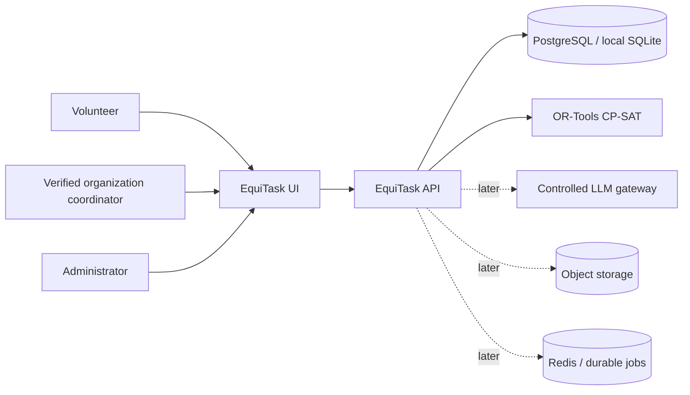
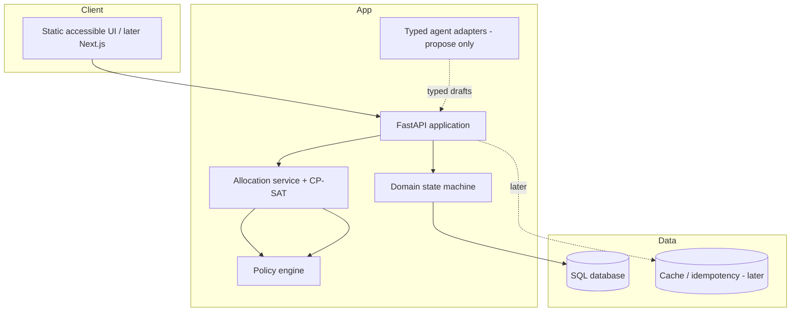
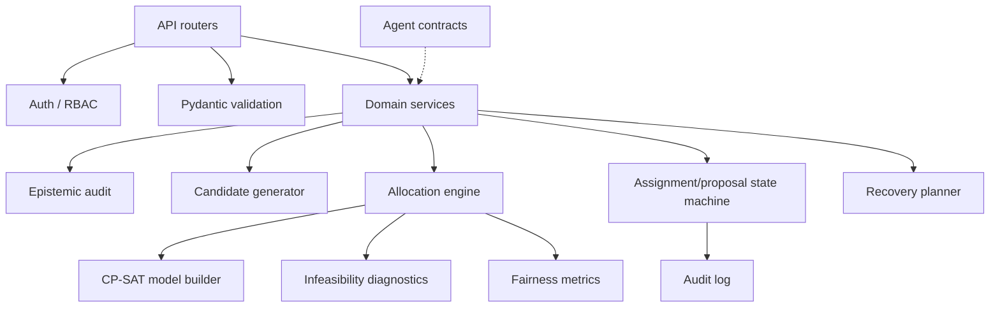
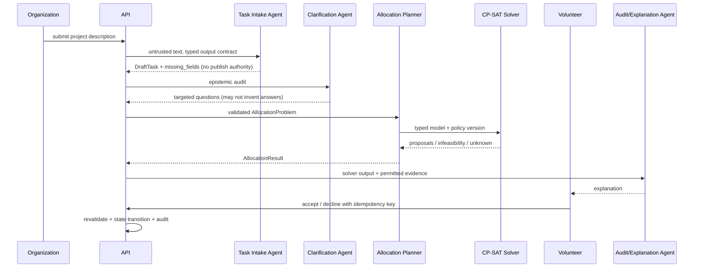
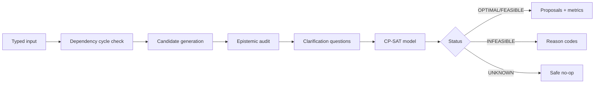
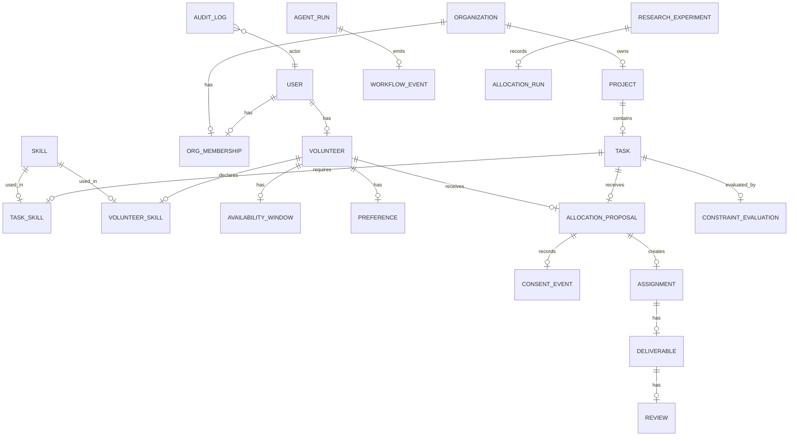
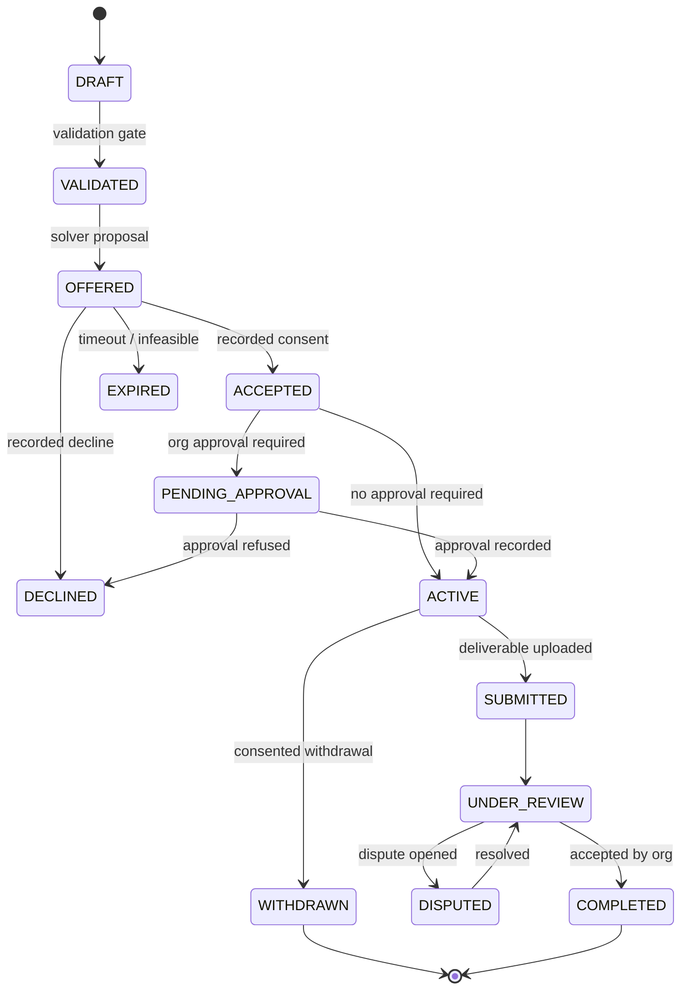
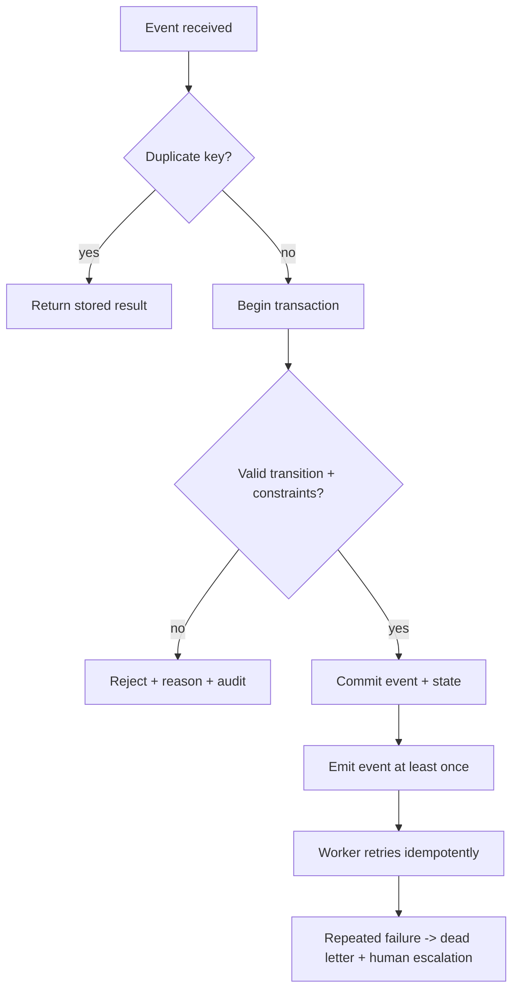
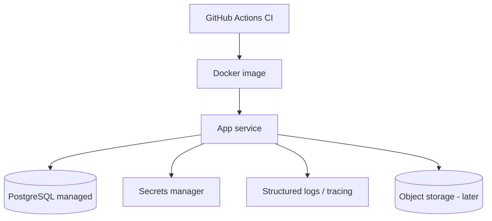
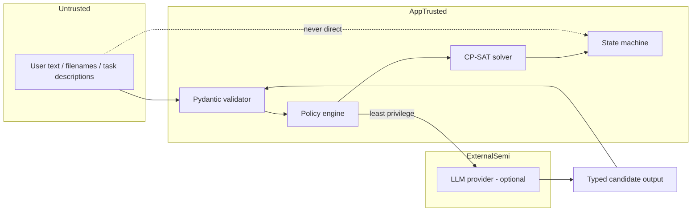

# Architecture — EquiTask AI

## Technology decision

Modular monolith. Python FastAPI + Pydantic + SQLAlchemy + PostgreSQL; local tests use SQLite. OR-Tools CP-SAT is an in-process authoritative library. Redis, durable workflows (e.g. Temporal) and Next.js are planned for later slices when operational need is demonstrated. The current runnable UI is accessible static HTML served by FastAPI; this is an explicit scope limitation, not a claim that Next.js is implemented.

## 1. System context

## 2. Container architecture

## 3. Component architecture

## 4. Multi-agent interaction sequence

## 5. Allocation pipeline

## 6. Database ER diagram

## 7. Assignment state machine

## 8. Failure and recovery flow

## 9. Deployment architecture

## 10. Trust boundary and data flow

Rules:
- Untrusted text is delimited and never given tool authority.
- Agent output must pass Pydantic + policy validation before any state change.
- Solver output is authoritative for feasibility; explanations never create rights.
- Organization tenant ID is checked on every query.

## Indexes and migrations

Initial indexes: `users.email` unique, `organizations.verification_status`, `tasks.project_id`, `tasks.status`, `allocation_proposals.task_id`, `allocation_proposals.volunteer_id`, `assignments.volunteer_id`, `audit_logs.created_at`. Migrations are managed by Alembic; retention and deletion policies are specified in `docs/THREAT_MODEL.md`.
